<p align="center">
  
  &nbsp;&nbsp;
  
</p>

<h1 align="center">Veil</h1>

<p align="center"><b>Separate identities. One private browser.</b><br>
A 4 MB browser for macOS, Windows and Linux — every profile is its own device.</p>

<p align="center">
  <a href="https://github.com/JKS-sys/veil-releases-11-Oct-2026/releases/latest"><b>Download the latest release</b></a> ·
  <a href="#plans">Plans</a> ·
  <a href="#demos">Demos</a> ·
  <a href="#screenshots">Screenshots</a>
</p>

<picture>
  <source media="(prefers-color-scheme: light)" srcset="docs/light-identities.png">
  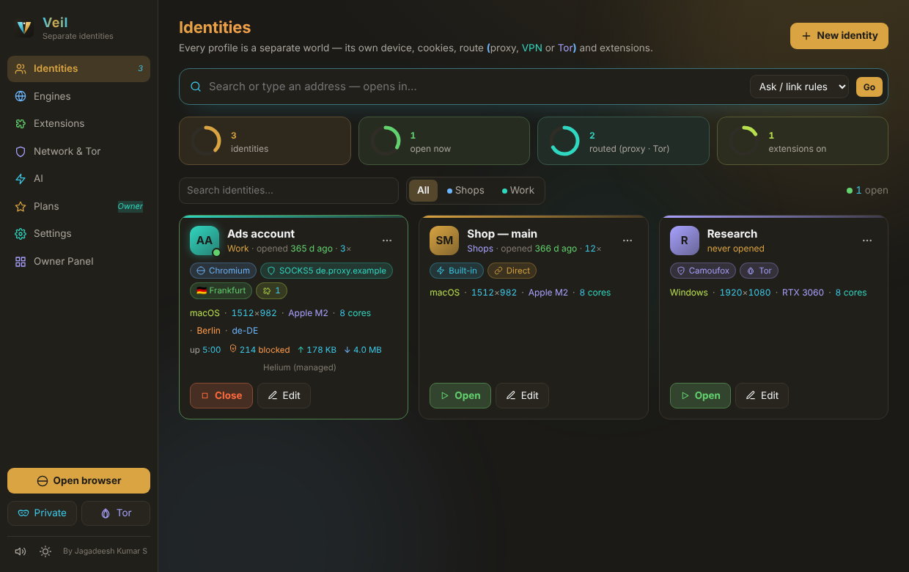
</picture>

Every profile is a separate world: a different fingerprint, separate cookies and sessions, and your own choice of proxy, VPN, Tor route and extensions. One identity never follows another.

Websites link accounts when they come from the same device, and then one ban takes them all. In Veil each account runs in its own profile, so every site sees a different device.

By **Jagadeesh Kumar S**, creator · [youtube.com/@JKS-sys](https://www.youtube.com/@JKS-sys) · [Sponsor](https://razorpay.me/@NSBJKS)

---

## Size and speed

| | |
|---|---|
| App binary | **4.3 MiB** (Linux x86_64 release; the budget is 5 MiB, and `tests/size.mjs` enforces it) |
| Stack | Tauri 2 + Rust + Preact. No HTTP or ZIP crates: Veil has its own small SOCKS/HTTP proxy, ZIP reader, SHA-256 and BLAKE2b; licence and update signatures are checked with a verify-only Ed25519. |
| Fastest engine | The **Built-in** engine is the system WebView: WebKit on macOS, Edge WebView2 on Windows, WebKitGTK on Linux. It adds no download, starts instantly and uses the least memory. |

Heavier engines are optional. They are downloaded once into Veil's own folder and are never bundled, which is how the app stays under 5 MB.

## The four engines

| Engine | What runs | Extensions | Fingerprint |
|---|---|---|---|
| **Built-in** | System WebView, with tabs in a Veil window | Windows (WebView2): Chrome extensions run natively. macOS and Linux: each extension's page scripts and styles run through Veil's extension layer (storage, messages, i18n, pop-ups and options pages); background parts need a Chromium or Firefox identity. | Veil Shield script, plus its own data store per profile |
| **Chromium** | Helium (one-click download), or an installed Brave, Thorium, Chromium, Vivaldi or BrowserOS | **Chrome Web Store** | Veil Shield, loaded as an extension in the page's main world, plus `TZ` and language |
| **Firefox** | An installed Firefox, LibreWolf, Floorp, Waterfox or Zen | **Firefox Add-ons** | Firefox's own fingerprinting protection, plus `user.js` privacy settings |
| **Camoufox** | Camoufox (one-click download) | **Firefox Add-ons** | Set at engine level: UA, OS, screen, WebGL, timezone, locale, geolocation and audio. It can claim any OS. |

Branded Google Chrome and Microsoft Edge (version 137 and later) ignore command-line extensions, so the Shield can't load in them. Veil marks them "No shield" and recommends Helium.

## What each profile gets

- **Its own device.** Screen, GPU (WebGL vendor and renderer), CPU cores, memory, canvas noise and audio noise come from the profile's own seed. The same profile looks the same every time; a different profile looks different. This is proven in Chromium by `shield_and_route_in_real_chromium`.
- **Its own storage.** Each profile has a separate data folder (or WebKit data store), so cookies, logins and history never cross. **Burner** profiles are wiped every time they close.
- **Its own route.** The options are Direct, HTTP, SOCKS5 or SOCKS4 with username and password, or **Tor with its own circuit** (Tor's `IsolateSOCKSAuth` option, with one login per profile).
  - The browser connects to a private local port, and Veil logs in upstream. DNS goes through the proxy, and the traffic counter shows up and down.
  - VPNs: use the provider's SOCKS5 or HTTP endpoint (Mullvad, NordVPN, PIA, Proton and others).
- **Location that matches the route.** "Test route" shows the exit IP, city and timezone. "Match proxy location at every launch" keeps timezone, language and geolocation consistent with the exit.
- **No WebRTC leaks.** By default WebRTC only goes through the route; you can also set it to Block.
- **Its own extensions.** Paste a Chrome Web Store or Firefox Add-ons link once, then switch the extension on per profile.
  - Chrome extensions **keep their store id**: Veil writes the CRX's signing key into the manifest, so sync and settings work. This is tested against the real Web Store.
  - Firefox add-ons are side-loaded signed, and switched-off ones are removed again.
  - You can also install from either store directly inside a profile.

## Opening Veil = opening your browser

Veil opens straight into your **Personal** browser window: cookies, logins, history and bookmarks are kept, and it is its own identity. Everything else — identities, engines, extensions, AI, network and settings — opens as a tab (grid and gear buttons in the toolbar, ⌘,) or in its own window (Window → Identities & Settings). Closing the last Veil window quits Veil completely. The start-up animation plays on the first window each launch (Settings → Appearance). Settings → Browsing switches this to open Identities & Settings instead.

Brave-style features in every Veil window:

- **Shields** (lion button): ads and trackers are blocked in Veil's own route before they leave the computer — a built-in list of about 3,600 hosts, "Update block lists" adds Peter Lowe's list and StevenBlack's hosts (about 75,000). The count ticks up live; click to lower Shields for one site. Shields work in Built-in, Chromium and Firefox identities. Cosmetic filtering hides empty ad boxes.
- **New Tab page**: clock, search, live Shields stats (blocked here, blocked since install, bandwidth and time saved), top sites, bookmarks.
- **Private window** (⇧⌘N) and **Private window with Tor** (⌥⌘N): fresh device, nothing kept, wiped when closed.
- **Bookmarks** (★ / ⌘D, bookmarks bar), **History** (⌘Y), **Downloads**, **Find in page** (⌘F), a choice of search engine (DuckDuckGo, Brave Search, Startpage, Mojeek, Ecosia, Bing, Google).
- **Address-bar suggestions**: a colourful panel (not the system list) that floats over the page on macOS and Windows with Open / Search / Ask Veil AI rows, your bookmarks and history with the match highlighted, and one-click AI and search engines. ↑ ↓ to move, Enter to open, Tab to complete, `@` for an engine, `?` for Veil AI.
- **Extensions button** (puzzle piece): switch your library's extensions on or off for this identity, and open their pop-up or options page in a tab.

Brave itself is not copied into Veil: brave-core is a Chromium fork of tens of gigabytes that builds to about 200 MB. Veil gives the same everyday features on the system engine, and can run Brave as an identity's engine when it is installed.

## Veil AI

- **Find every AI on this computer**: Ollama, LM Studio, Jan, GPT4All, Msty, AnythingLLM, llama.cpp / llamafile / LocalAI, KoboldCpp, vLLM, text-generation-webui, plus **GitHub Copilot** (the Copilot CLI), GitHub Models (through `gh`) and any OpenAI-compatible URL with a key.
- **GitHub Copilot with the CLI, signed in through your browser**: Veil installs the Copilot CLI (Homebrew, winget or npm), starts GitHub's sign-in, shows the one-time code and opens github.com/login/device. The same works for the GitHub CLI (GitHub Models). Copilot answers in an empty folder with no tools, so it can only answer. Models: GPT-5.4, GPT-5.3 Codex, GPT-5 mini, GPT-4.1.
- **Install** (Homebrew on macOS, winget on Windows, the official page elsewhere), **Start**, **download models** with live progress (Llama 3.2, Qwen 2.5, Gemma 3, Phi-4 mini, Mistral, DeepSeek R1, Qwen Coder, LLaVA, or any name), **delete models**, **Use** a model, and **Uninstall** (to the Trash / winget; optionally its models too).
- **The Veil AI window** (✦ in the toolbar, ⌘J) reads the tab in front: Summarise, Key points, Explain simply, Explain selection, Translate (11 languages), Fact-check, Draft a reply, Table, Explain code — or ask anything. Replies stream in, with coloured headings, lists and code (brackets coloured by depth).
- **Rewrite the selection**: Formal, Friendly, Shorter, Fix grammar, Bullet points, Simpler words.
- **All tabs at once** (Pro): Summarise all tabs, Compare tabs (a table and a pick), Research notes.
- **Saved chats and your own prompts** (Pro): keep a chat, reopen it later; save what you typed as a one-click prompt.
- **In the address bar**: `?question` asks Veil AI; `@perplexity`, `@chatgpt`, `@copilot`, `@duckai`, `@braveai`, `@you`, `@phind`, `@mistral`, `@grok` send the question to that AI; `@bing`, `@google`, `@brave`, `@wiki`, `@yt`, `@gh` … search there. Any of them can be the default engine (toolbar picker or Settings).

## Identities in tabs

The ⧉ menu next to + opens a tab in another identity inside the same window: its own cookies, fingerprint, proxy / VPN / Tor route and Shields, marked by a coloured badge on the tab. Links it opens stay in that identity. Chromium and Firefox identities (with their own extensions) still open in their own windows.

## Your everyday browser

- **Set Veil as the default browser** in Settings → *Your everyday browser*. On macOS you confirm the system prompt; on Windows Veil registers itself and opens *Default apps*; on Linux it installs `veil.desktop` and calls `xdg-settings`.
- **Links from other apps** open where you choose: the **chooser** (a small window; keys `1`–`9`, ↑ ↓ Enter, Esc; "Always open this site here" remembers per site), a fixed identity, or a fresh Burner. A link for an identity that is already open becomes a new tab in it (Built-in window, Chromium, or Firefox).
- **Address bar** on the Identities page: type a site or a search and pick the identity.
- **Extensions**: switching a Chrome extension on moves the identity to Chromium; a Firefox add-on moves it to Firefox or Camoufox. Helium or Camoufox is fetched automatically the first time — so Veil works as one browser with both stores. (The system WebView itself cannot run store extensions on macOS or Linux; on Windows WebView2 runs Chrome extensions.)
- **App icon**: Dark, Light, or Match theme (Settings → Appearance).

## Using it

- **New identity**: pick an engine, name it, and set a proxy if you want one. Then press **Open**.
- **Burner window** (⇧⌘N): a throwaway Built-in window with a fresh device. Everything is gone when you close it.
- In a Built-in window: ⌘T new tab, ⌘W close tab, ⌘L address bar, ⌘R reload, ⌘[ / ⌘] back and forward, ⌃Tab next tab. Downloads go to `~/Downloads`.
- Desktop shortcut for one identity: `veil --profile "Shop main" [url]`.
- In each identity's ⋯ menu: Duplicate as new device · New fingerprint · Open the store · Check fingerprint (BrowserLeaks) · Show data folder · Clear cookies and data.

<a id="plans"></a>
## Plans

| | Free · ₹0 | Pro · ₹20 a month | Pro · ₹220 a year |
|---|---|---|---|
| Built-in browser, Shields, private windows, New Tab | ✓ | ✓ | ✓ |
| Identities (own device, cookies, proxy / VPN, extensions) | 3 | unlimited | unlimited |
| Chrome Web Store and Firefox Add-ons | ✓ | ✓ | ✓ |
| Veil AI with local AI, address-bar AI engines | ✓ | ✓ | ✓ |
| Identities in tabs (several accounts in one window) | | ✓ | ✓ |
| Tor routes and private windows with Tor | | ✓ | ✓ |
| Camoufox engine | | ✓ | ✓ |
| GitHub Copilot in Veil AI, AI across all tabs, saved chats and prompts | | ✓ | ✓ |
| Automatic weekly Shields list updates | | ✓ | ✓ |

Pay with UPI, cards or net banking through Razorpay (Settings → Plans), or enter an activation code (`VEIL-XXXX-XXXX-XXXX`). A licence is signed by Veil's service, bound to one computer by an anonymous hash, checked offline, renewed daily, and keeps working for 7 days when you are offline.

## Updates

Settings → Updates (or **Veil → Check for Updates…**). Veil asks **GitHub (public)** first, then **GitHub (private)** through Veil's service, then **Cloudflare R2**. The first one that answers decides; the download falls back to the R2 copy of the same file. Every update is checked against Veil's signing key before it replaces the app.

<p align="center">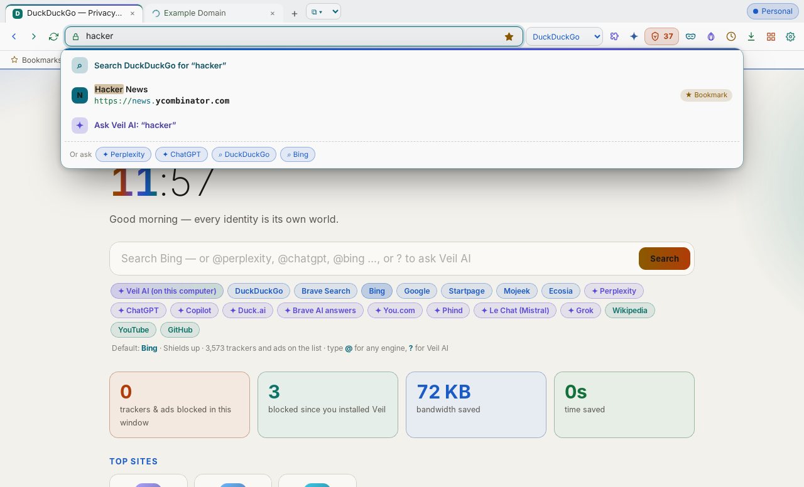</p>

## Privacy and problem reports

Once a day Veil sends an anonymous computer hash, its version, system, chip and plan, so the creator knows how many computers use it. Pages, history, identities and proxies never leave your computer. Turn sending off in Settings → Updates.

Problems are collected from every part of Veil — Rust panics, JavaScript errors in every window (toolbar, tabs, Veil AI, the chooser), windows or tabs that could not open, macOS crash reports (`~/Library/Logs/DiagnosticReports/veil-*.ips`) and problems you describe yourself in **Settings → Problems → Report**. They are sent a few seconds after they happen, in batches, with your home folder replaced by `~`, and each one shows *sent* or *queued*. In the Owner Panel they arrive grouped by kind and version, with how many computers saw each one; **Send a test report** checks the whole path.

<a id="demos"></a>
## Demos

**Address bar** — suggestions, `@` engines, `?` for Veil AI, and the extensions button
<br> &nbsp; [mp4](docs/demo-address-bar.mp4)

**Plans, activation code and Owner Panel**
<br> &nbsp; [mp4](docs/demo-plans-owner.mp4)

**Veil AI** — GitHub Copilot sign-in through the browser, then a streamed answer about the page
<br> &nbsp; [mp4](docs/demo-ai.mp4)

**The real app** (Linux, WebKitGTK): suggestions, an extension's page script running in a Built-in window, the extensions menu, its options page, and the plans opening when a Pro feature is used
<br>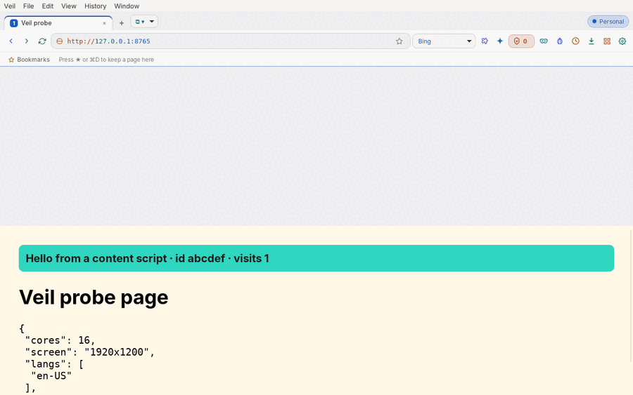

<a id="screenshots"></a>
## Screenshots

| Dark | Light |
|---|---|
| 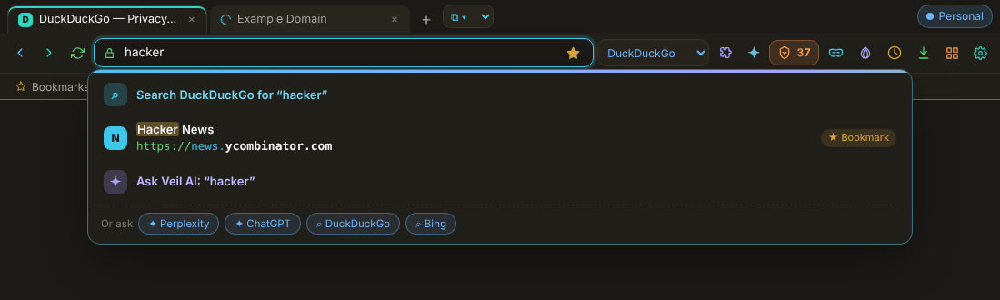 | 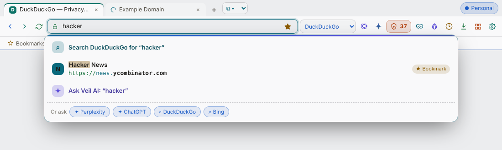 |
| 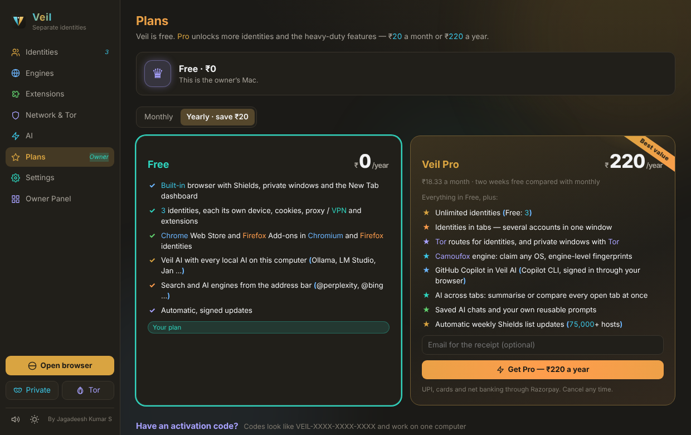 | 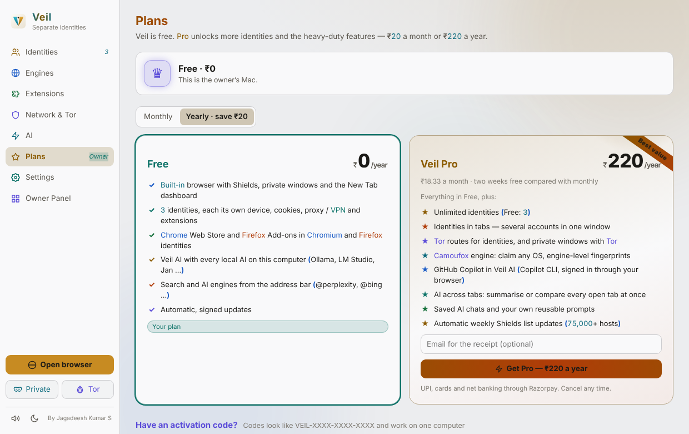 |
| 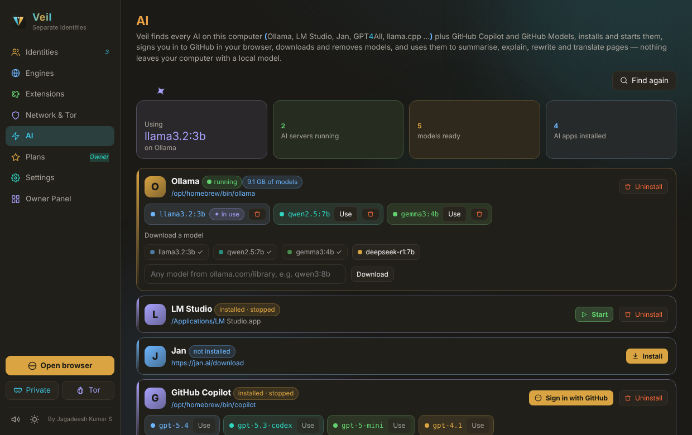 | 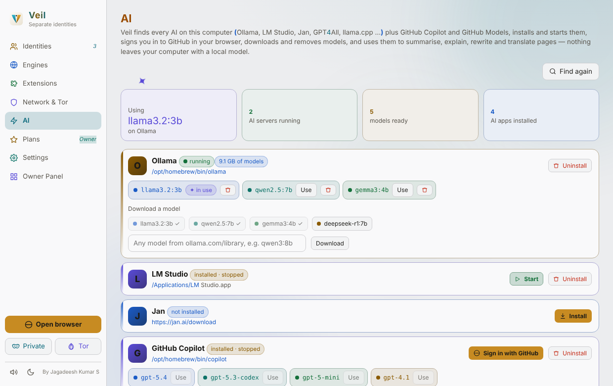 |
| 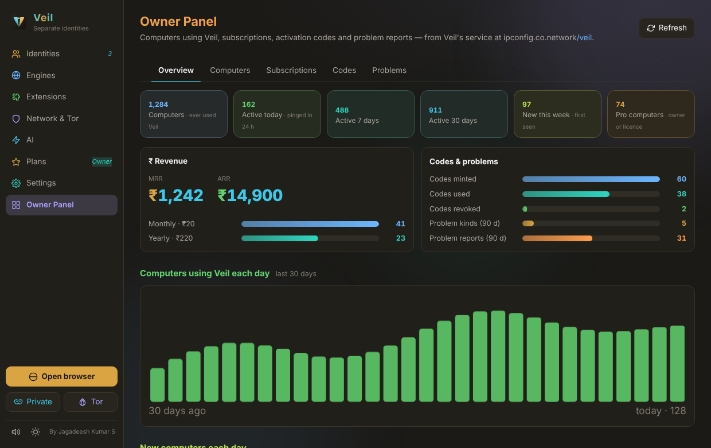 | 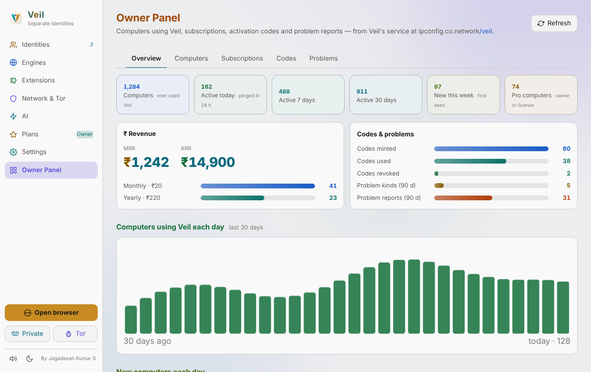 |

Real app on Linux:

| | |
|---|---|
| 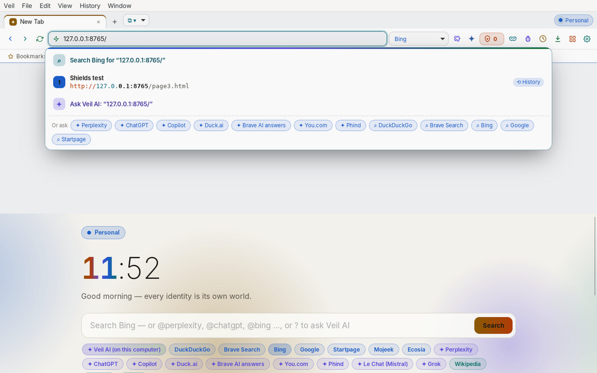 | 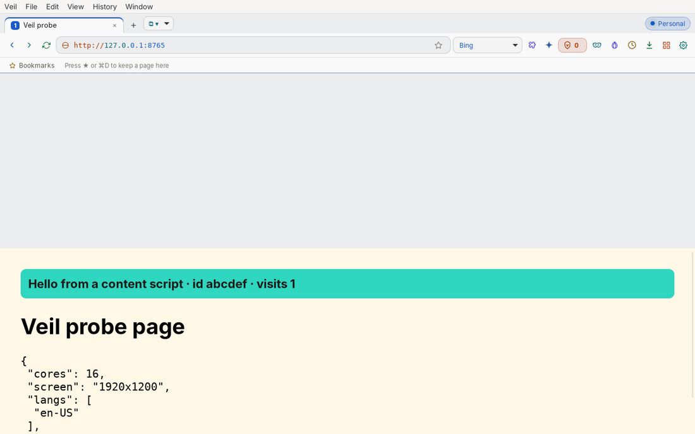 |
| 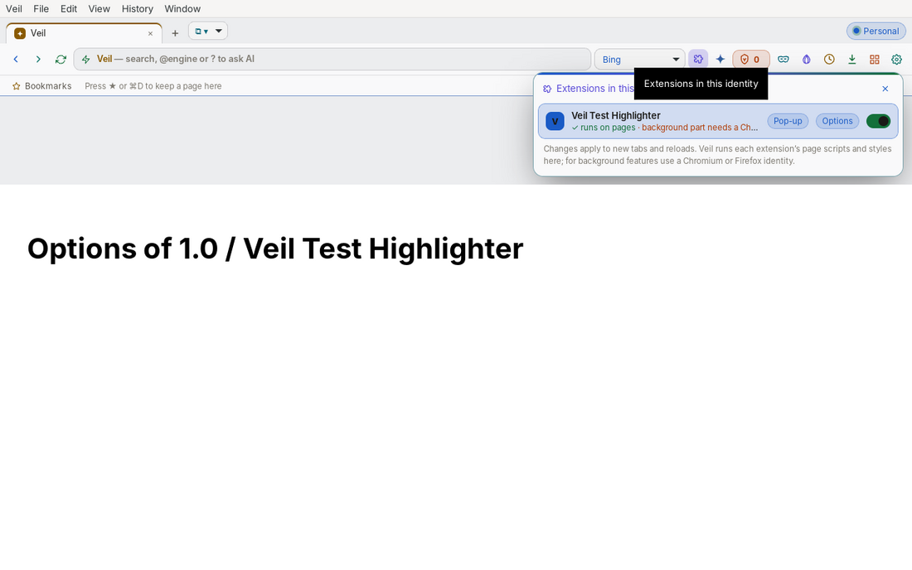 | 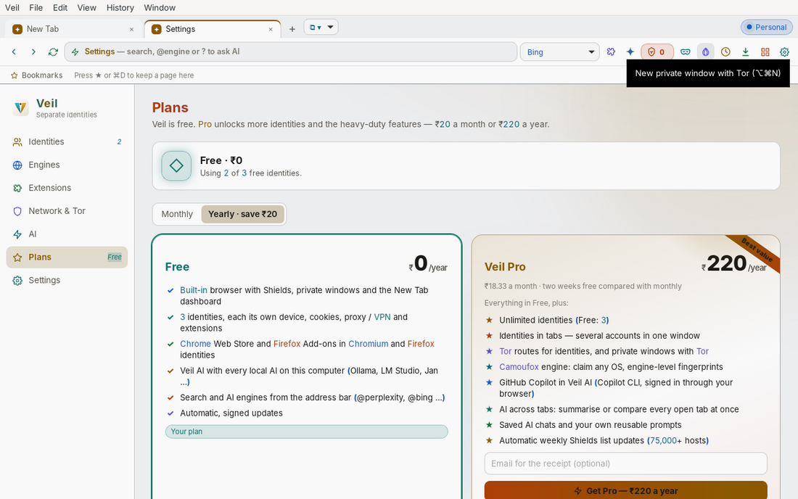 |

## macOS DMG

`bash build.sh` builds the `.app` and then makes `Veil_<arch>.dmg` with `hdiutil` (`scripts/make-dmg.sh`). Tauri's own DMG step is skipped because its Finder script fails on folders with spaces and on a leftover mounted "Veil" volume.

## Release (creator)

`bash update.sh` does everything in one go: checks `.env` (names only), makes the licence key once, deploys Veil's Cloudflare Worker with its D1 database and R2 bucket `veil-11-oct-2026`, bumps the version, runs every test, builds and signs both Mac architectures, writes the notes and `latest.json`, pushes the source to the private repo `veil-11-Oct-2026` and this README to the public repo `veil-releases-11-Oct-2026`, uploads the installers to both GitHub repos and to R2 (`latest.json` last), and only then deletes the old installers from GitHub and R2. The `release` workflow builds Windows and Linux from the tag, uploads them to all three places and prunes their old files the same way.

`bash update.sh --doctor` only checks; `--service` only deploys the Worker; `--dry-run` builds without publishing.

## Build

```bash
bash build.sh          # tests → release build → Mac signing with one stable identity → size check
bash build.sh --e2e    # also runs real Chromium + real store downloads
npm run dev            # UI with demo data in a normal browser (never live endpoints)
node tests/ui.mjs      # Playwright over every view, both themes, under the app's CSP
```

On Linux you need `libwebkit2gtk-4.1-dev libgtk-3-dev librsvg2-dev`. `.github/workflows/build.yml` builds macOS (arm64 and x64), Windows, and Linux (x64 and ARM64).

## Tests

- **Rust** (55 tests, plus 3 end-to-end):
  - The proxy: HTTP rewrite, SOCKS5 with auth, a wrong password gives a 502 with the reason, and HTTP upstream with Basic auth.
  - ZIP: traversal refused, CRC checked.
  - CRX3: picks the key whose hash matches the id.
  - SHA-256 test vectors, fingerprint determinism, Camoufox env chunking, `user.js` routing, the store file kept when broken, address-bar parsing.
- **End-to-end** (`--ignored`):
  - Real Chromium with the Shield and the local route: cores, screen, languages, timezone (offset −540 for Tokyo), WebGL renderer, GPC, a native-looking `toString`, and traffic counted through the route. Canvas differs between profiles and stays stable within one.
  - Real Chrome Web Store and AMO downloads.
  - Licences: Ed25519 tokens bound to one computer, and a Worker-signed licence verified by the app.
  - Updates: minisign signatures from the real `tauri signer` verify; the source order is GitHub public → private → R2.
  - Extensions: content scripts, styles, locale messages and pop-up pages for the Built-in engine.
- **Worker** (`node worker/test/worker.test.mjs`): the whole service on SQLite with Razorpay and GitHub faked — installs, problem dedupe, the owner gate, codes (unique, one computer each, revoke, lifetime), subscriptions (paid, cancelled, plan change, MRR/ARR), the webhook signature and update files.
- **UI**: Playwright with zero page errors (every view, both themes, suggestions, extensions menu, Copilot sign-in, plans, codes, Owner Panel, updates), plus a check that every colour token is at least 4.5:1 with no pink hues.

## Sources studied

Donut Browser (profile and proxy model), Camoufox (config keys), Helium, Thorium, BrowserOS, Floorp, Otter, Beaker, Browserosaurus, Kiwi, DuckDuckGo's apple-browsers, Brave and Tor. Veil runs these engines; it does not copy their code.
